# Personal Health Copilot - System Architecture

## Overview
Personal Health Copilot is an AI-powered healthcare web application that organizes, extracts, summarizes, and translates complex medical documents (prescriptions, laboratory reports, diagnostic scans, discharge summaries) into understandable health insights.

```mermaid
graph TD
    User([User / Patient]) -->|HTTPS| ReactFrontend[React + Vite + TypeScript Frontend]
    
    subgraph Frontend Layer
        ReactFrontend --> Nav[Searchable Language Selector 80+ Languages]
        ReactFrontend --> Dash[Dashboard & Trend Charts Recharts]
        ReactFrontend --> UploadUI[Drag-n-Drop Upload & Verification Form]
        ReactFrontend --> FHIRUI[FHIR R4 JSON Exporter]
    end

    ReactFrontend -->|REST API Axios| FastApiBackend[FastAPI Python Backend]

    subgraph Backend Intelligence Pipeline
        FastApiBackend --> DocumentProcessor[Document Processing Orchestrator]
        DocumentProcessor --> PyMuPDF[PyMuPDF PDF Text Extractor]
        DocumentProcessor --> OCR[Layout-Aware OCR Service]
        DocumentProcessor --> Classifier[Rule-Based & AI Document Classifier]
        DocumentProcessor --> AIExtractor[Google Gemini API / Structured Extractor]
        DocumentProcessor --> Validator[Pydantic Medical Data Validator]
        DocumentProcessor --> SummaryService[AI Health Summary Generator]
        DocumentProcessor --> TransService[AI Medical Content Translator]
        DocumentProcessor --> FHIRService[FHIR R4 Resource Exporter]
    end

    Backend -->|SQLAlchemy ORM| Database[(SQLite / PostgreSQL Database)]
    
    subgraph Database Models
        Database --> PatientsTable[Patients]
        Database --> MedicalRecordsTable[MedicalRecords]
        Database --> LabResultsTable[LabResults]
        Database --> MedicationsTable[Medications]
        Database --> HealthSummariesTable[HealthSummaries]
        Database --> DocumentEventsTable[DocumentEvents]
    end
```

## AI & Document Processing Pipeline Steps
1. **Upload & Storage**: Files are saved securely with unique UUID prefixes.
2. **Text Extraction**: PyMuPDF extracts text page-by-page. Image OCR runs on scanned documents.
3. **Document Classification**: Classifies into Prescription, Laboratory report, Diagnostic report, Discharge summary, or Medical history.
4. **Structured Information Extraction**: Google Gemini API extracts test names, values, units, reference ranges, and medications into structured JSON.
5. **Validation**: Pydantic schema validation flags values outside reference bounds and sets verification statuses (`Extracted`, `Needs Review`, `User Verified`).
6. **Summary & Translation**: Generates plain-language medical summaries and translates summaries into Telugu (`te`), Hindi (`hi`), and other selected languages while preserving numerical values, units, and drug names.
7. **FHIR R4 Export**: Maps records into valid HL7 FHIR R4 Bundle resources (Patient, Observation, MedicationRequest, DocumentReference).

## Security & Privacy Considerations
- **Backend API Credentials**: The `GEMINI_API_KEY` is exclusively managed on the backend and never exposed to client browsers.
- **Medical Disclaimer**: Prominent safety disclaimers inform users that the system does not replace professional medical advice.
- **Demo Fallback**: Works completely offline or in keyless mode using synthetic structured data parsing.
